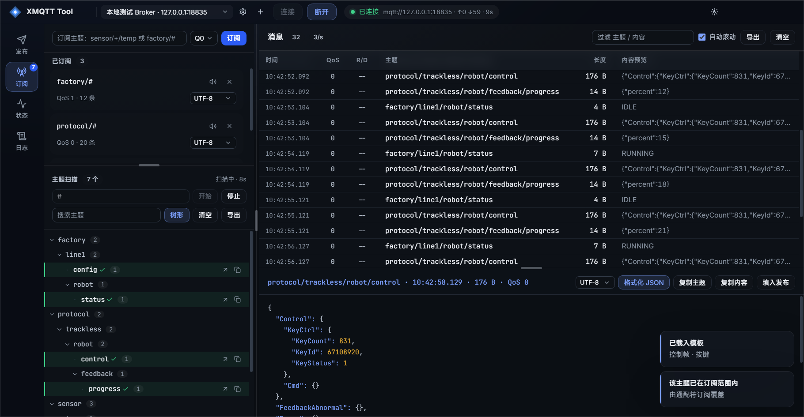
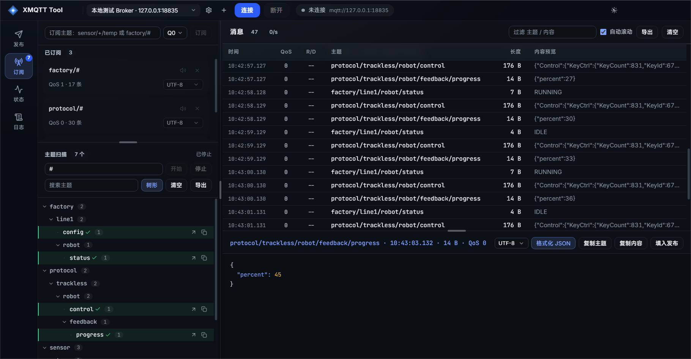

# XMQTT Tool

[](LICENSE)
[](#快速开始)

> **开源（AGPL-3.0）。** 可自由使用、修改、商用；一旦分发或作为网络服务提供，必须公开完整源码。

参考 MQTT.fx 打造的 MQTT 订阅 / 发布调试工具，基于 **Electron 28 + Node.js**，界面为现代深色/浅色双主题。

面向的是「手边没有公共 broker、机器不能上外网」的现场调试场景：连接管理、订阅查看、主题扫描、消息模板都在本地完成，不依赖任何在线服务。



> 「订阅」与「主题扫描」已合并为一个**主题工作台**：左边扫描出 broker 上的主题，点一下即订阅，右边立刻看到数据。  
> 完整截图见 [screenshots/](screenshots)（发布 / 工作台 / 平铺 / 状态 / 日志 / 浅色主题 / 离线态）。

---

## 快速开始

本项目**跨平台**，Windows / Linux / macOS 共用同一份源码。

### Windows

**平时启动**：双击桌面上的 `XMQTT Tool` 快捷方式即可（它指向本项目的 `start.cmd`）。  
快捷方式丢了就把 `start.cmd` 右键「发送到 → 桌面快捷方式」重建一个，起始位置无所谓，脚本内部会自己切到本地目录。

首次使用需要先装配依赖（离线机无外网，从本地离线资源装配）：

```powershell
node tools/assemble-deps.mjs        # 只需执行一次
```

然后任选一种方式启动：

```powershell
.\start.cmd                                          # 双击 / 命令行都行，最省事
node tools/launch.js                                 # 走 Node 启动器，终端里能看到应用日志
pwsh -ExecutionPolicy Bypass -File tools\start.ps1   # 分离启动，脚本立即返回
```

> **执行策略**：离线机 CurrentUser / LocalMachine 都是 `RemoteSigned`，而项目位于网络共享盘（UNC 路径会被 PowerShell 当成远程文件），所以直接跑 `.\tools\start.ps1` 会被拦下。`start.cmd` 内部已经带了 `-ExecutionPolicy Bypass`，双击即可；要在终端里手动跑 `.ps1`，请照上面第三种写法补上该参数。

### macOS

依赖走 npm，Electron 二进制（darwin-arm64 / darwin-x64）随依赖一起下载：

```bash
npm install
./start.sh                 # 启动；首次运行会自动构建 dist/renderer
./start.sh --devtools      # 带开发者工具
```

打安装包：

```bash
npm run dist:mac           # build + 生成图标 + 产出 dmg / zip（arm64 + x64）
```

产物在 `release/`，例如 `release/XMQTT Tool-1.0.0-arm64.dmg`。  
`.app` 未做代码签名（`mac.identity: null`），首次打开会被 Gatekeeper 拦一下：

```bash
xattr -dr com.apple.quarantine "/Applications/XMQTT Tool.app"
```

或者右键 .app →「打开」→「打开」。

macOS 上与本项目相关的三处平台差异（其余逻辑全平台共用）：

1. **窗口红绿灯**：用 `titleBarStyle: 'hiddenInset'` + `trafficLightPosition`，红绿灯压在自绘顶栏左上角，  
   所以 `.titlebar` 在 `html[data-platform='darwin']` 下把左内边距放大到 86px；右侧不再需要给原生按钮留白。
2. **菜单**：mac 必须有一个应用菜单（关于 / 服务 / 隐藏 / 退出），否则 ⌘Q、⌘H、Dock 菜单都不正常；  
   另外多一栏「窗口」提供 ⌘M / ⌘W。Windows / Linux 仍是「文件」里带「退出」。
3. **GPU 与沙箱**：mac 真机默认**不**关 GPU、**不**加 `--no-sandbox`（关掉反而拖慢滚动与动画）。  
   Windows 远程会话 / Linux 无头环境仍然默认关闭。需要强制软件渲染时设 `XMQTT_SOFTWARE_RENDER=1`。

快捷键在 mac 上按 `⌘` 处理（发布框里 `⌘+Enter`，同时兼容 `Ctrl+Enter`）。

> **受限环境装不上 Electron**（报 `ENOENT .../Library/Caches/electron/...`，常见于沙箱 / CI / 无家目录写权限）：  
> 把缓存指到项目内再装：  
> `electron_config_cache="$PWD/.electron-cache" npm install`

### Linux

```bash
npm install
./start.sh                 # 启动
./start.sh --devtools      # 带开发者工具
```

国内网络加速（三个平台通用）：

```bash
npm config set registry https://mirrors.tencent.com/npm/
export ELECTRON_MIRROR=https://npmmirror.com/mirrors/electron/
npm install
```

> **无图形界面的服务器**：Electron 是 GUI 程序，必须有 X server。纯 SSH 环境请先装虚拟显示：  
> `sudo apt install -y xvfb libnss3 libatk-bridge2.0-0 libgbm1 libasound2`，然后 `xvfb-run -a ./start.sh`；  
> 或者直接去有桌面的机器运行。`./start.sh` 会先检测 `DISPLAY`，缺失时给出上述提示，而不是让 Electron 抛一句 `Missing X server`。
>
> 只想验证 MQTT 核心逻辑（不开窗口）：`node tools/test-manager.mjs`。

想先在没有现场设备时看看效果，可以用自带的本地 broker：

```bash
# 终端 A：起 broker 并周期性灌入模拟报文
node tools/dev-broker.mjs

# 终端 B：启动界面，服务器下拉选「本地测试 Broker」→ 点「连接」
./start.sh        # Linux / macOS
.\start.cmd       # Windows
```

---

## 功能

| 模块          | 能力                                                                                                                          |
| ----------- | --------------------------------------------------------------------------------------------------------------------------- |
| **连接管理**    | 多服务器配置持久化；协议 mqtt / mqtts / ws / wss；Client ID、用户名密码、MQTT 3.1/3.1.1/5.0、Keep Alive、Clean Session、自动重连、TLS 跳过校验、遗嘱消息；配置导入导出  |
| **主题工作台**   | 一个界面完成「扫描 → 订阅 → 查看」：通配符扫描 broker 上真实存在的主题，按 `/` 分层成可折叠主题树，**点主题行即订阅**、点中间层订阅整棵子树 `xxx/#`；已订阅的行标 ✓ 并高亮；树形 / 平铺可切换；主题可搜索、可导出 |
| **订阅管理**    | 通配符 `+` / `#`；每个订阅独立的消息解码方式（UTF-8 / HEX / Base64）；单条订阅静音；退订                                                                 |
| **消息查看**    | 时间、QoS、Retain/Dup 标记、字节数、内容预览；按主题或内容实时过滤；详情面板一键格式化 JSON 并语法着色；复制主题 / 复制内容 / 填入发布框；导出 CSV / JSON / TXT                       |
| **发布**      | 主题 + Payload + QoS 0/1/2 + Retain；Payload 支持 UTF-8 / HEX / Base64 编码；JSON 一键格式化；`Ctrl+Enter` 快捷发布；发布历史一键重发                  |
| **消息模板**    | 把常发的报文格式存成模板（含主题、载荷、QoS、Retain、编码），一键载入或直接发送                                                                                |
| **日志 / 状态** | 分级日志（信息 / 成功 / 错误）可过滤、可导出；状态页显示连接详情、收发统计、运行时长与订阅表                                                                           |

### 离线态

断开连接后，所有**必须经由 broker 才能完成**的动作会统一变灰禁用：订阅、扫描、发布、模板直发、历史重发、静音、退订、改解码方式。  
而纯本地的操作照常可用（填主题、写报文、搜索、查看与导出已收到的消息）—— 这样现场可以先离线把报文准备好，连上再发。



---

## 环境适配说明（重要）

Windows 与 Linux 的环境约束差别很大，下面分平台记录，避免以后重复踩坑。

### A. Windows（离线机 / UNC 盘）

#### A1. 完全离线

离线机 `registry.npmjs.org` 与 `registry.npmmirror.com` 均不可达，**不能执行 `npm install`**。  
`tools/assemble-deps.mjs` 从本机既有资源离线装配 `node_modules`：

- **mqtt 依赖闭包**来自本机其它工程的 `node_modules`（默认 `D:\deps\mqtt-deps\node_modules`，可用 `XMQTT_DEP_SRC` 覆盖）——该目录是 Bun 隔离布局，存在普通名、`.name-HASH` 哈希副本、嵌套依赖三种形态。脚本按 `package.json` 递归解析闭包并扁平化拷贝，同时对每个候选包做**有效性校验**——该源里 `.debug-PxZlHyt2` 是空壳目录（只有空 `src/`、没有 `package.json`），必须回退到其它源才能拿到真正的 `debug`。
- **Electron 二进制**来自 `%LOCALAPPDATA%\electron\Cache\electron-v28.3.3-win32-x64.zip`，解压到 `node_modules/electron/dist` 并补写 `path.txt`。
- 拷贝统一用 **robocopy**：实测 `fs.cpSync` 在「本地盘源 → UNC 网络共享目标」组合下会**静默丢文件**（29 个文件只拷过去 2 个且不报错）。

#### A2. UNC 工作目录

项目可能位于网络共享盘（`\\fileserver\shared\...` 这类 UNC 路径），而 Windows 的 `CreateProcess` 不接受 UNC 路径作为工作目录。  
因此 `tools/launch.js` / `tools/start.ps1` 会先把子进程的工作目录设到本地临时目录，再用绝对路径拉起 Electron —— 直接用 `electron .` 是起不来的。

#### A3. ELECTRON_RUN_AS_NODE

DSH / Codex 这类宿主的进程环境里带 `ELECTRON_RUN_AS_NODE=1`（宿主自己用它把 electron 当 node 跑）。  
继承下来会让本项目的 `electron` 退化成纯 Node，`require('electron')` 拿不到 `app` / `BrowserWindow`，表现为**进程一闪而退**。  
启动脚本会在 spawn 时把它从环境里剔除。

#### A4. Chromium 沙箱

本机是远程/虚拟机会话，Chromium 的 GPU 子进程在受限令牌下起不来：

```
ERROR:gpu_process_host.cc(987)] GPU process launch failed: error_code=18
FATAL:gpu_data_manager_impl_private.cc(448)] GPU process isn't usable. Goodbye.
```

Electron 会在窗口出现之前整体退出（双击没反应）。启动脚本默认带 `--no-sandbox --disable-gpu`。  
安全性上没有实质损失：界面只加载本地 HTML/CSS/JS，CSP 限制为同源，渲染层 `contextIsolation` 且无 Node 能力，不加载任何远程内容。  
若在沙箱正常的普通桌面环境使用，可传 `-Sandboxed` / `--sandboxed` 关掉该参数。

#### A5. start.cmd 必须纯 ASCII

`cmd.exe` 按 OEM 代码页（简体中文机器为 936）读取 `.cmd` 文件，UTF-8 中文注释会被解成乱码字节并切碎命令行  
（实测报 `'em' is not recognized`、`'0start.ps1"'`，即 `rem` 和 `%~dp0` 被从中间截断），  
表现为双击毫无反应。所以根目录的 `start.cmd` 保持**纯 ASCII**，中文提示一律放在  
`tools\start.ps1`（UTF-8 **带 BOM**，PowerShell 才读得对）。

同理，`start.cmd` 里引用启动脚本必须写全 `%~dp0tools\start.ps1` —— 早期版本误写成同目录，双击永远找不到脚本。

---

### B. Linux / macOS

#### B1. 依赖走 npm 镜像

Linux 上不再使用离线装配脚本，直接 `npm install`。国内环境建议先配镜像：

```bash
npm config set registry https://mirrors.tencent.com/npm/
export ELECTRON_MIRROR=https://npmmirror.com/mirrors/electron/   # Electron 二进制单独走这个
```

#### B2. 可执行文件名不同

Windows 是 `electron.exe`，Linux/macOS 是 `electron`（无后缀）。  
所有脚本统一通过 `tools/lib/electron-path.js` 解析：优先读 `node_modules/electron/path.txt`（electron 包安装时写入的权威文件名），读不到再按 `process.platform` 兜底。  
**新增脚本不要自己拼 `electron.exe`** —— 跨平台迁移时最容易漏的就是这种字面量。

#### B3. 必须有 X server

Electron 是 GUI 程序，Linux 上需要 X11（Wayland 会话下走 XWayland）。  
纯服务器 / 纯 SSH 环境没有 `DISPLAY`，直接启动只会得到：

```
ERROR:ozone_platform_x11.cc(240)] Missing X server or $DISPLAY
ERROR:env.cc(257)] The platform failed to initialize.  Exiting.
```

`./start.sh` 会在启动前检测 `DISPLAY` / `WAYLAND_DISPLAY`，缺失时打印可执行的解决方案，而不是让 Electron 抛错。  
无头验证走 `xvfb-run -a ./start.sh`。

#### B4. SUID sandbox（仅 Linux）

普通用户直接运行 Electron 时，若 `chrome-sandbox` 没有正确的 SUID 位（root:root + 4755）会启动失败。  
`tools/launch.js` 在 Linux / Windows 上默认带 `--no-sandbox`；**macOS 不带**（mac 走 seatbelt，不需要也不该关）。  
正式分发时如需沙箱，按 Electron 官方文档给 `chrome-sandbox` 补权限，并用 `--sandboxed` 启动。

#### B5. FUSE 挂载的权限位

项目若放在某些 FUSE / SMB 挂载上（例如飞牛 NAS 的 `/vol1`），**新建或覆写出来的文件权限位会落成 `000`**，  
普通读写会被内核拒绝。用编辑器 / 脚本改完文件后要补权限：

```bash
chmod 644 <文件>       # 普通文件
chmod 755 <脚本>.sh    # 可执行脚本
```

#### B6. macOS 的窗口外壳（红绿灯 / 菜单 / GPU）

这三处是 mac 与 Windows 的真实差异，都在代码里按平台分支处理了，改的时候别只改一边：

| 项        | macOS                                                                                                                                                      | Windows / Linux                                                                                             |
| -------- | ---------------------------------------------------------------------------------------------------------------------------------------------------------- | ----------------------------------------------------------------------------------------------------------- |
| 标题栏      | `titleBarStyle: 'hiddenInset'` + `trafficLightPosition: {x:16,y:13}`，红绿灯由系统绘制在左上角，CSS 用 `html[data-platform='darwin'] .titlebar { padding-left: 86px }` 让位 | `titleBarStyle: 'hidden'` + `titleBarOverlay`，原生按钮在右上角，CSS 用 `.titlebar__right { padding-right: 138px }` 让位 |
| 菜单       | 必须有应用菜单（关于 / 服务 / 隐藏 / 退出），否则 ⌘Q、⌘H 与 Dock 菜单不正常；另加「窗口」栏给 ⌘M / ⌘W                                                                                          | 「文件」菜单里带「退出」，不加「窗口」栏                                                                                        |
| GPU / 沙箱 | 默认**不**关 GPU、**不**加 `--no-sandbox`（关掉会让滚动和动画退化成 CPU 光栅）                                                                                                    | 默认 `--disable-gpu --no-sandbox`，否则远程会话 / 无头环境起不来                                                            |

`XMQTT_SOFTWARE_RENDER=1` 可强制任意平台走软件渲染（排查花屏时有用）。  
平台标识由 `preload.js` 在首帧前写进 `<html data-platform>`，CSS 据此排版 —— 不要改成在渲染层用 JS 判断，  
那样会先闪一下再跳位。

#### B7. 打包（electron-builder）

`npm run dist:mac` 会依次 `npm run build`（主进程 esbuild + 渲染层 vite）→ 生成图标 → 打 dmg / zip（arm64 + x64），产物在 `release/`。

- `mac.identity: null`：不做代码签名。分发给别人时对方首次打开会被 Gatekeeper 拦，需右键「打开」或  
  `xattr -dr com.apple.quarantine "/Applications/XMQTT Tool.app"`。
- 只出当前机器架构可以加速：`npx electron-builder --mac dmg --arm64`。
- 受限环境（无法写 `~/Library/Caches`）下打包要设 `ELECTRON_BUILDER_CACHE`，否则解压缓存写不进去：  
  `ELECTRON_BUILDER_CACHE="$PWD/.eb-cache" npx electron-builder --mac dmg --arm64`
- Electron 二进制走 `build.electronDownload.mirror`（npmmirror），国内不用另配代理。
- 打包产品的 `asar` 按 `build.files` 收文件；`node_modules` 里只有 `mqtt` 及其依赖是运行期需要的，  
  渲染层那套 React/Radix（重写计划预装、当前未引用）已排除。

---

## 目录结构

```
XMQTT.Tool/
├─ start.cmd                Windows 双击入口（纯 ASCII，转发到 tools\start.ps1）
├─ start.sh                 macOS / Linux 启动入口（缺产物时自动 build）
├─ build/                   打包资源：icon.png / icon.icns（npm run icon 生成）
├─ release/                 electron-builder 产物：.app / .dmg / .zip
├─ src/
│  ├─ main/                 主进程（TypeScript，esbuild 编到 dist/main/）
│  │  ├─ main.ts            窗口 / 菜单 / 生命周期（窗口外形与菜单按平台分支）
│  │  ├─ mqtt-manager.ts    MQTT 连接池、订阅表、主题收集（不依赖 Electron，可单独测试）
│  │  ├─ store.ts           配置持久化（原子写）
│  │  └─ ipc.ts             IPC 路由（通道名取 @shared 的 INVOKE 常量）
│  ├─ preload/preload.ts    contextBridge 白名单 API + 写入平台标识（编到 dist/preload/）
│  ├─ shared/               主进程与渲染层共享的 IPC 契约（models / channels / bridge）
│  └─ renderer/             渲染层（TypeScript + React，单一 ESM 入口）
│     ├─ main.tsx           入口：装测试门面 window.__xmqtt + createRoot 挂载外壳
│     ├─ app.ts             引导：灌初始快照、绑定事件、离线态开关
│     ├─ global.d.ts        window.xmqtt 与 window.__xmqtt 的全局声明
│     ├─ index.html         只剩布局槽位（titlebar / rail / content / toasts）
│     ├─ styles/            tokens.css（设计令牌）+ app.css（组件层）
│     ├─ layout/            AppShell / TitleBar / Rail
│     ├─ views/             PublishView / WorkbenchView / StatusView / LogView / ServerEditor
│     ├─ components/        Icon / Button / Field / Empty / Toggle / Dialog
│     ├─ ipc/               client（类型化调用）/ events（事件下行）
│     ├─ lib/               util / payload / filters / topic-tree / server-draft / dialog / connection / theme / config
│     └─ store/             types（状态形状）+ appStore（zustand + 选择器）
├─ dist/                    构建产物（不入库）：main / preload / shared（esbuild）+ renderer（vite）
├─ tools/
│  ├─ start.ps1             Windows 启动脚本（环境适配逻辑都在这里）
│  ├─ launch.js             npm start 入口（跨平台，Chromium 参数按平台给）
│  ├─ dev.js                开发模式（Vite dev server + Electron）
│  ├─ build-main.mjs        主进程/preload 编译入口（esbuild 逐文件转 CJS）
│  ├─ lib/electron-path.js  Electron 可执行文件解析（按平台，唯一入口）
│  ├─ lib/build-main.js     编译实现（buildMain / ensureMainBuild，被各启动器复用）
│  ├─ assemble-deps.mjs     Windows 离线依赖装配（其它平台走 npm install）
│  ├─ make-icon.mjs         生成应用图标（Electron 渲染 SVG → PNG → icns）
│  ├─ dev-broker.mjs        本地测试 broker（含模拟产线报文）
│  ├─ test-manager.mjs      Manager 层功能测试（33 项，跑 dist/ 产物）
│  ├─ unit-test.mjs         单元测试运行器（esbuild 打包 → node --test，54 项）
│  ├─ smoke-test.mjs        基础链路冒烟（7 项）
│  ├─ e2e-test.mjs          端到端测试（36 项，CDP 驱动真实窗口）
│  ├─ gen-icons.mjs         从 lucide 生成 lib/icons.ts
│  └─ screenshots.mjs       界面截图生成
└─ screenshots/             界面截图
```


```

渲染层已全量迁到 TypeScript + React（`strict`，零 `.js` 源码），单一 ES module 入口
`src/renderer/main.tsx`，由 Vite 打成 `dist/renderer/assets/*.js`，生产环境通过自定义
`app://` 协议加载 —— 这样 `webSecurity` 与 `script-src 'self'` 都能保持开启。

模块之间是真正的 `import` / `export`，依赖方向单向：
`layout/` → `views/` → `components/` → `lib/` → `store/`。视图互不引用，
跨视图动作（如「填入发布框」后跳页）走 store 的 action。

状态只有一份：`store/appStore.ts`（zustand）。主进程推来的是**快照**，
连接 / 订阅 / 主题的真实状态仍在 `mqtt-manager.ts` 里，渲染层不做本地推断。

主进程与渲染层现在**共用同一份类型**：`src/shared/` 里的 `models.ts`（领域模型）、
`channels.ts`（通道名 + 入参/返回映射）、`bridge.ts`（`window.xmqtt` 的形状）。
主进程 `ipc.ts` 与 preload 都按这套类型标注，改一个通道签名时两端同时编译报错。

主进程是 TypeScript，由 `tools/lib/build-main.js` 用 esbuild **逐文件**编成 CJS 落在
`dist/main` / `dist/preload` / `dist/shared`。刻意不用「打包成单文件」：
`mqtt-manager` 编出来是独立文件，才能被 `tools/test-manager.mjs` 在裸 node 里直接
require 跑 33 项测试（它不 import electron，不需要起窗口）。

`window.__xmqtt` 是给 e2e 与截图脚本的测试门面，只暴露
`getState / subscribe / actions / api / dialog / switchView / selectors`，
没有「替视图重绘」这类后门 —— 测试要改状态走 action，与真实调用方同一条路径。

---

## 测试

```bash
# 单元测试：store 裁剪与派生、主题增量、树构建、过滤、载荷编码、配置映射、弹层契约
node tools/unit-test.mjs           # 54 项（esbuild + node --test，零额外依赖）

# Manager 层：真实 broker 上跑连接/订阅/发布/静音/编码/主题扫描（无需 GUI，跑 dist/ 产物）
node tools/test-manager.mjs        # 33 项

# 基础冒烟
node tools/smoke-test.mjs          # 7 项

# 端到端：真实窗口 + CDP 驱动 DOM，覆盖 渲染层→preload→IPC→主进程→broker→回推 全链路
node tools/e2e-test.mjs            # 36 项

# 重新生成界面截图
node tools/screenshots.mjs
```

`test-manager` / `e2e` / `screenshots` 在启动前都会自动跑一次主进程编译（`tools/lib/build-main.js`），
所以改了 `src/main/*.ts` 直接跑测试即可，不必手动 build。

`npm test` 会把单测和 Manager 测试一起跑。e2e 需要显示环境（Linux 用 `xvfb-run -a`）。

`test-manager.mjs` 与 `e2e-test.mjs` 依赖 `aedes`（本地 broker）。它是测试专用依赖，需要时单独装配：

```powershell
$env:XMQTT_EXTRA_PACKAGES='aedes'; node tools/assemble-deps.mjs --only=packages
```

---

## 配置存放

默认落在系统用户数据目录下的 `xmqtt-config.json`（服务器配置、消息模板、发布历史、界面设置）：

| 平台 | 路径 |
| --- | --- |
| Windows | `%APPDATA%\XMQTT Tool\xmqtt-config.json` |
| macOS | `~/Library/Application Support/XMQTT Tool/xmqtt-config.json` |
| Linux | `~/.config/XMQTT Tool/xmqtt-config.json` |

体积小、纯 JSON，三个平台之间可以直接拷贝迁移（菜单「文件 → 打开配置目录」能定位到它）。
设置环境变量 `XMQTT_USER_DATA` 可整体搬到指定目录，用于便携模式或隔离测试。

其他可用环境变量：
- `XMQTT_DEVTOOLS=1` 启动时打开开发者工具
- `XMQTT_DEP_SRC` / `XMQTT_ELECTRON_ZIP` 覆盖离线装配源路径

---

## 快捷键

| 按键 | 作用 |
| --- | --- |
| `Ctrl+Enter` / `⌘+Enter` | 在 Payload 编辑区快捷发布 |
| `Enter` | 在订阅输入框中直接订阅 |
| `Esc` | 关闭弹层 |
| 点击主题行 | 订阅该主题（已在订阅范围内则只提示，不重复订阅） |
| 点击中间层 | 展开 / 折叠该层主题 |

---

## 已知边界

- 主题扫描通过通配符订阅实现，会占用一条订阅；停止扫描时会自动退订，已收集的主题列表保留（断开连接时扫描状态一并复位，但已收集的主题不丢，方便跟前一次对照）。
- 扫描期间收集到的消息不会灌进消息列表（只在主题树里体现），避免全量流量淹没订阅视图。
- 消息列表默认保留最近 5000 条（可在配置里调整 `maxMessagesPerSub`）。
- 未做消息持久化，关闭即清空；需要留档请用各视图的「导出」。

---

## 许可证

本项目采用 **GNU Affero General Public License v3.0**（`AGPL-3.0-only`），全文见 [LICENSE](LICENSE)。

**可以**：商用、修改、分发、私有部署，包括在公司内部或商业项目里使用，无需付费。
**条件是**：一旦**分发**（打包给对方、上架应用商店）或**作为网络服务提供**给他人，必须同时提供完整源码，且衍生作品同样采用 AGPL-3.0。

> AGPL 比 GPL 多一条第 13 条「远程网络交互」：把修改版做成在线服务让人通过网络使用，视同分发，同样要提供源码。这正是它防止「拿开源代码做个闭源 SaaS」的方式。
>
> 不愿公开自己修改内容的商业用户，需另行取得商业授权。

**分发二进制时的合规要点**：AGPL 要求随二进制提供「对应源码」的获取方式。把本仓库地址（或打包时的源码 tag）放进应用「关于」页或随附的说明文件即可满足，不需要把源码打进安装包。

内置第三方资源，其许可证不受本项目协议影响：

| 资源 | 许可证 | 与 AGPL 的兼容性 |
| --- | --- | --- |
| Inter / JetBrains Mono | SIL Open Font License 1.1 | 兼容，可随作品内嵌分发 |
| MiSans | 小米 MiSans 知识产权许可协议 | 允许随软件内嵌分发 |
| 运行时依赖 | MIT / ISC / Apache-2.0 / BSD / MPL-2.0 | 全部兼容（宽松协议可并入 AGPL，无 GPL 冲突） |

