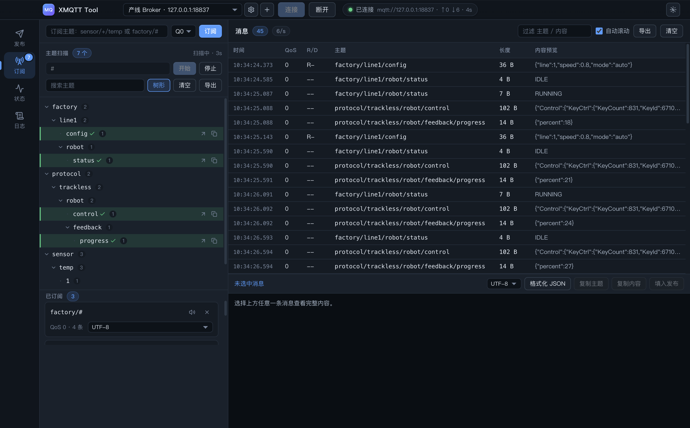
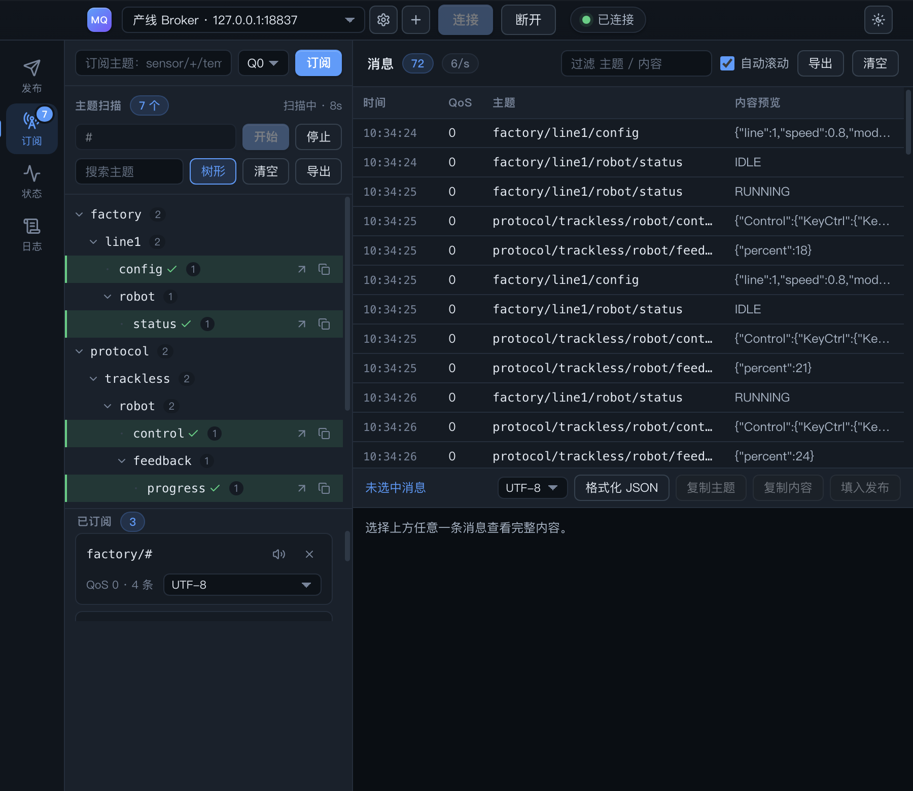
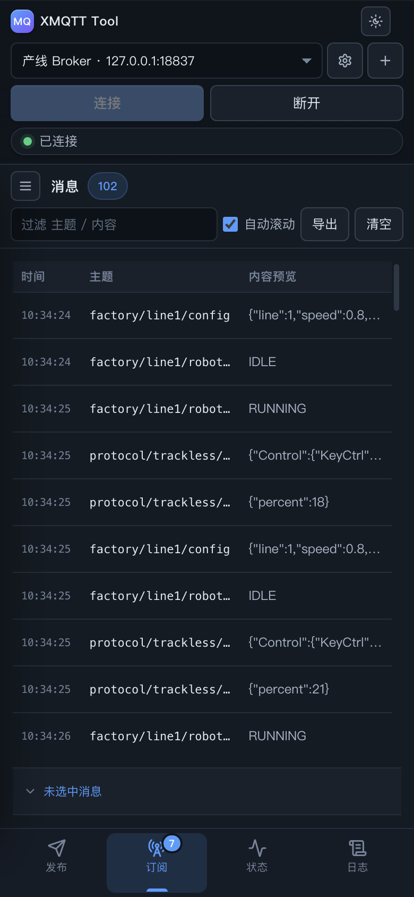
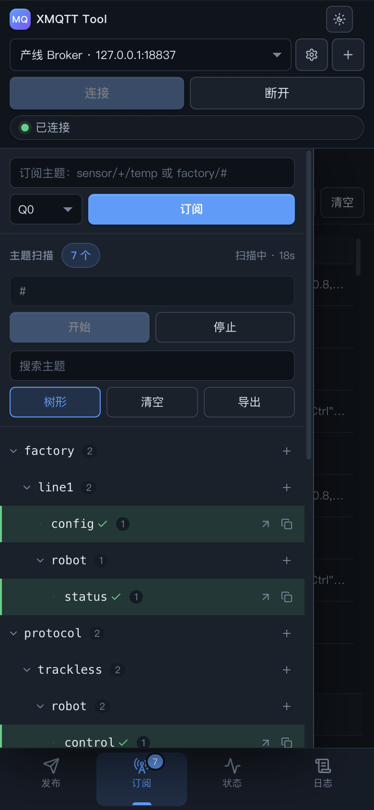
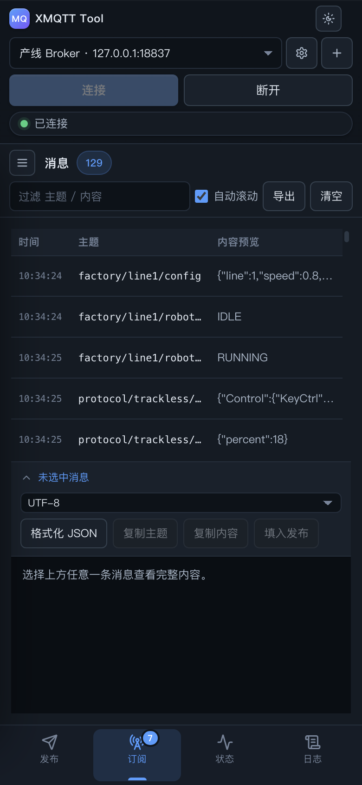
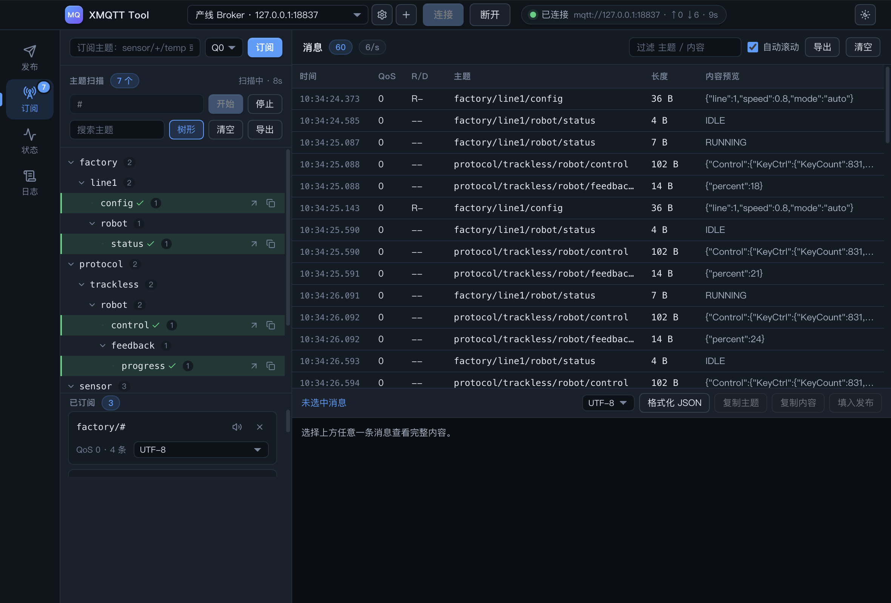

# XMQTT Tool 响应式适配设计（桌面优先）

> **状态：已落地。** 2026-10-25 完成 P0–P4，验收：单测 33/33、e2e 36/36、
> 几何断言 53/53（`npm run check:responsive`）、桌面几何逐项不变。
> 实施中新增的四个坑见 [§5.5](#55-实施阶段真正踩到的四条动笔时没想到) —— 其中
> `width: auto` 列在跨断点后不吸收剩余宽度这一条，靠肉眼几乎发现不了。
>
> 目标：同一套渲染层，能同时跑在桌面窗口与手机屏幕上；
> **约束：桌面体验一个像素都不许退**。
>
> 配套原型：[`responsive-preview.html`](./responsive-preview.html) —— 打开后可拖动宽度、
> 切换指针类型、切换主题，实时看四个档位的差异。原型用的是与 `src/renderer` 相同的
> 类名（`.app` / `.titlebar` / `.rail` / `.split--browser` / `.msg-detail` …），
> 里面的 CSS 可以直接搬进 `app.css`。

---

## 1. 结论先行

| # | 主张 | 理由 |
| --- | --- | --- |
| 1 | **不做"移动版"，只做"降级层"** | 两套界面 = 两套 bug、两份状态。移动端必须只是桌面布局的减列、换位置、加高，信息架构一个字不改 |
| 2 | **结构与密度用两把不同的尺子量** | 结构看**宽度**，密度看**指针能力**。只用宽度判定，桌面用户把窗口拖到 900px 就会得到 44px 行高与巨大按钮 —— 这就是"为了手机牺牲电脑"的典型死法 |
| 3 | **降级规则物理隔离在 `@media` / `@container` 内** | 桌面分支的 CSS 解析结果一个字节都不变，可以用截图 diff 证明，不用靠"我觉得没影响" |

最后一条是这次设计的核心承诺，也是可验收的：**桌面档的几何量必须逐项不变**
（实测结果见 §6）。

---

## 2. 判据模型

```
               ┌─ 视口宽度 ──→ 外壳结构：标题栏行数 / 导航在哪 / 主栅格列数
  布局 ◄───────┤
               └─ 容器宽度 ──→ 内容结构：分栏方向 / 表格列 / 详情形态

  密度 ◄───────── 指针能力（hover / pointer）──→ 行高、控件高度、点击目标
```

**为什么要分成视口和容器两把尺子：**

- 外壳（`.titlebar` / `.rail` / `.body` 栅格）跟着窗口走 —— 它没有"自己的宽度"。
  这里用媒体查询。
- 视图内部（`.split--browser` / `.table` / `.msg-detail`）跟着**它实际拿到的宽度**走。
  将来主窗口旁边开一个独立浮窗、或用户把分栏拖窄，视口宽度就不代表面板宽度了。
  这里用 `@container`，宿主给 `.content` 挂上即可。

```css
/* 唯一一处容器宿主的声明 */
.content { container-type: inline-size; container-name: view; }
```

**为什么密度不看宽度：**

现场排障的典型姿势是「工具窗口 + 抓包/文档」并排，窗口常年 900–1100px。
如果按宽度提密度，这批用户会立刻感到"界面变糙了"。而真正的手机/平板
`(pointer: coarse)` 本来就该给更大的点击目标 —— 两件事正交，必须分开判。

---

## 3. 四个档位

| 档 | 触发 | 名称 | 导航 | 工作台分栏 | 发布页 | 密度 |
| --- | --- | --- | --- | --- | --- | --- |
| A | ≥ 1280 | **wide** | 80px 常驻竖栏 | 树 `380px` + 表格 | 表单 + 模板 `320px` | 28 / 30 |
| B | 1024–1279 | **wide-narrow** | 80px | 树 `clamp(300px, 26vw, 380px)` | 模板 `clamp(260px, 24vw, 320px)` | 不变 |
| C | 768–1023 | **compact** | 64px | 树 `clamp(240px, 34%, 300px)` + 表格（仍双栏） | 模板 `clamp(240px, 28vw, 300px)` | 不变 |
| D | < 768 | **phone** | 底部 Tab（56px + 安全区） | **单列**：树变抽屉，表格满宽 | 上下叠，模板区 34vh | 44 / 36 |

三个刻意的决定：

1. **C 档不做结构手术。** 900px 宽时树压到 300px、表格还剩 550px，照样能一屏看
   「主题 → 报文」的因果关系。把树收成抽屉能多给表格 300px，但每次切主题都要多一次
   点击 —— 这是拿桌面效率换整洁，不做。
2. **D 档的导航落在底部，但保留文字标签。** 纯图标在排障现场认不出来（"哪个是订阅？"）。
   10px 的中文标签在 56px 高度里完全放得下。
3. **宽档位只做 `clamp` 微调，不动任何结构。** `380px` → `clamp(300px, 26vw, 380px)`
   在 1440px 下算出 374px（差 6px），在 1920px 下仍是 380px。属于提升，不属于降级。

### 四档实拍（真机，不是原型）

下面六张全部来自**改造后的真实应用**：本地起 broker 灌产线报文，用 CDP 切视口与指针能力后截图。

| 1390（wide，六列） | 900（compact，四列） |
| --- | --- |
|  |  |

| 390（phone，触屏密度） | 390 抽屉展开 |
| --- | --- |
|  |  |

| 390 详情展开 | 1180（六列仍放得下） |
| --- | --- |
|  |  |

对比 1390 与 900：**行高没变、树还在左侧** —— 只少了 `R/D` 与 `长度` 两列。
对比 900 与 390：导航换到最下面、树进了抽屉、表格只留三列、详情收成一条、
时间列藏掉毫秒（`10:30:54` 而不是被压成 `10:30:54…`）、行高与控件抬到 44/36。


---

## 4. 各视图的降级规格

### 4.1 外壳

| 元素 | ≤1023 | ≤767 | 说明 |
| --- | --- | --- | --- |
| 标题栏高度 | 40 | 88（两行） | 手机一行放不下"服务器选择 + 连接 + 断开 + 状态" |
| 品牌名 | 隐藏 | 显示（12px） | 窄档位让位给服务器选择；手机档第一行有余量 |
| 服务器选择 | `flex: 0 1 240px` | 独占一行，高 34 | 手机上必须能点准 |
| 连接 / 断开 | 不变 | 各占一半宽度，高 34 | 主操作进拇指区 |
| URL / 速率 / 时长 | **隐藏** | 隐藏 | 状态页有完整数据，标题栏只留"已连接 + 指示灯" |
| 导航 | 80 → 64px | 底部 Tab，`env(safe-area-inset-bottom)` | 选中条：左竖线 → 底横线 |

### 4.2 主题工作台（重点）

**左栏 → 抽屉（仅 D 档）**

```css
@media (max-width: 767px) {
  .split--browser { grid-template-columns: minmax(0, 1fr); }
  .pane--workbench {
    position: absolute; inset: 0 auto 0 0; z-index: 9;
    width: min(84%, 340px);
    transform: translateX(-101%);          /* 不用 display:none */
    transition: transform 200ms var(--ease-out);
  }
  .split.is-drawer-open .pane--workbench { transform: translateX(0); }
}
```

用 `translateX` 而不是 `display:none`：树的展开态、滚动位置、已订阅列表全部原地保留。
本项目主题树不做虚拟化，卸载重挂会丢折叠状态 —— 这条和现有架构直接相关。

唤出入口放在消息表头部左侧（`☰`），只在 D 档出现。

**消息表**

| | A/B | C | D |
| --- | --- | --- | --- |
| 列 | 时间 / QoS / R/D / 主题 / 长度 / 预览 | 时间 / QoS / 主题 / 预览 | 时间 / 主题 / 预览 |
| 行高 | 28 | 28 | 44 |
| 主题列宽 | 32% | 46% | 44% |

保留「时间 + 主题 + 预览」的理由：这三列构成"什么时候、哪来的、说了什么"，
是排障时唯一不可省的。QoS / R/D / 长度全在详情条里，牺牲它们不损失信息。
**行高固定这一条不动** —— 虚拟滚动、`padTop/padBottom` 垫片、`useVirtualizer`
全部原样工作。

**详情面板**

| | A/B/C | D |
| --- | --- | --- |
| 形态 | 固定在底部，40%（C 档 46%） | 40px 折叠条，点开 52% |
| 理由 | 表格与详情同屏对照 | 竖屏 40% 会吃掉一半列表；"选中即展开"会打断连续浏览 |

### 4.3 发布

- D 档 `grid-template-rows: minmax(0, 1fr) auto`，模板列表变成底部 34vh 区。
- 主按钮「发布」吸底（`position: sticky; bottom: 0`）—— 单手操作时主操作必须在拇指区。
- 触屏键盘弹起时用 `visualViewport` 把聚焦的输入滚入视野（只在 `pointer: coarse` 下挂监听）。

### 4.4 状态 / 日志

已经是流式布局（`repeat(auto-fit, minmax(220px, 1fr))`、单列日志），**不需要改结构**，
只跟随密度层变行高与字号。这两个页面天然响应式，是当初就写对了的部分。

---

## 5. 六个必须提前知道的坑（都在这个仓库里）

### ① `ROW_HEIGHT` 常量与 CSS 行高是两份真相

```ts
const ROW_HEIGHT = 28;   // WorkbenchView.tsx
```
```css
.table tbody td { height: 28px; }
```

D 档要把行高抬到 44。只要两边不同步，虚拟滚动的滚动条长度就和内容错位，
而且**不会报错**，只是"滚到底还差一截"。做法：

```css
:root { --table-row-h: 28px; }
.table tbody td { height: var(--table-row-h); }
```

```ts
/** 行高只从 CSS 读，禁止再写字面量 */
function useRowHeight(): number {
  const read = () =>
    parseFloat(getComputedStyle(document.documentElement).getPropertyValue('--table-row-h')) || 28;
  const [h, setH] = useState(read);
  useEffect(() => {
    const mq = matchMedia('(pointer: coarse)');
    const sync = () => setH(read());
    mq.addEventListener('change', sync);
    return () => mq.removeEventListener('change', sync);
  }, []);
  return h;
}
```

### ② 表格列宽写在 inline style 里，媒体查询压不过

现在 6 个列宽都是 `style={{ width: 104 }}`。inline style 的优先级高于任何选择器，
D 档想改列宽只能 `!important`，然后一路失控。
**先把列宽挪进 CSS**（`.msg-table th:nth-child(n)`），JSX 只留语义。这是本次改造的前置动作。

### ③ 隐藏列必须同时命中 `th` 和 `td`

只写 `.table thead th:nth-child(3){display:none}` 的话，表头少一列、单元格还在，
`table-layout: fixed` 的列宽会整体错位 —— 表现是"主题列被压成 50px"。
原型第一版就踩了这条，截图一出来就看见了：

```css
.table thead th:nth-child(3), .table tbody td:nth-child(3),
.table thead th:nth-child(5), .table tbody td:nth-child(5) { display: none; }
```

代价是选择器绑定了列顺序。加列时必须同步改这里 —— 写进注释，别让它变成暗礁。

### ④ `@container` 规则必须排在所有基础规则之后

同级特异性的规则，后写的赢。如果把 `.msg-detail__body { display:flex }` 写在
容器查询后面，D 档的 `display:none` 会被它覆盖，详情永远折叠不上。
所有降级规则集中在 `app.css` 末尾一个区块，基础规则一律在它上面。

### ⑤ 三个 portal 槽位锁死了 DOM 顺序

`index.html` 里只有 `#titlebar-root` / `#rail-root` / `#content-root` 三个槽位，
导航"落到底部"**不能**靠把 `<nav>` 挪到 `<main>` 后面。只能靠 `.body` 的栅格：

```css
.body { grid-template-columns: 1fr; grid-template-rows: minmax(0,1fr) auto; }
.rail { grid-row: 2; flex-direction: row; }
.content { grid-row: 1; }
```

好处是 e2e 的 `[data-view]` 点击路径完全不变。

### ⑥ `-webkit-app-region: drag` 会吞掉触摸事件

标题栏是拖拽区。D 档标题栏变高到 88px 后，拖拽区面积翻倍，
里面按钮的 hit-test 会变得不稳定。触屏下直接关掉：

```css
@media (pointer: coarse) { .titlebar { -webkit-app-region: no-drag; } }
```

桌面（鼠标）不受影响 —— 窗口仍然可以拖。

---

## 5.5 实施阶段真正踩到的四条（动笔时没想到）

### ⑦ 固定列宽下 `width: auto` 不保证"吸收剩余宽度"

这是本次唯一一个**静默**的坑：CSS 看起来完全合理，桌面档、紧凑档都正常，
只有从 900px 切到 390px 之后，预览列会停在 34px —— 表格宽 357，三列却只有 253，
右侧凭空空出 104px。不报错、不抛异常，只是"为什么预览只有三个字符"。

```css
/* ✗ 跨断点后可能不被重新分配 */
.table .col-prev { width: auto; }
```

原因：`table-layout: fixed` 的列宽在首次布局后会被缓存，容器查询改写列宽时，
`auto` 列不一定会重新参与"剩余宽度分配"。90% 的场景能对，10% 的场景错得毫无痕迹。

**结论：窄档位一律用纯百分比，各列相加正好 100%。** 没有"剩余"，就没有分配失败：

```css
@container msg (max-width: 479px) {
  .table .col-time  { width: 18%; }   /* 64px @357 */
  .table .col-topic { width: 42%; }   /* 150px */
  .table .col-prev  { width: 40%; }   /* 143px */
}                                      /* 100%，精确填满 */
```

代价是时间列的像素宽度随面板浮动（357→64px、327→59px）。可以接受：
窄档位本来就是"按比例分地"，不是"按像素对齐"。

### ⑧ `calc(% - px)` 在表格列宽里不可用

理论上 `.col-prev { width: calc(58% - 64px) }` 是最优雅的写法：剩余全给预览列。
实测**不成立** —— 表格列宽里的百分比不是按表格宽度解析的，`calc(56% - 128px)`
在 543px 宽的表格上算出 59px（真值应为 176px）。这条不要试，直接走纯百分比。

### ⑨ 时间列的毫秒要单独包一层，用 CSS 藏

时间列在宽档位 104px 放得下 `10:30:54.123`，窄档位只剩 64px ——
保留毫秒的结果是整列被压成 `10:30:54…`，**连秒级信息一起丢**。

不要在 JS 里判断宽度（那会引入 resize 监听 + 二次渲染）。把毫秒拆成独立元素：

```tsx
<td className="col-time cell-time">
  {fmtTime(m.ts, false)}
  <span className="cell-time__ms">{fmtMs(m.ts)}</span>
</td>
```
```css
@container msg (max-width: 719px) { .cell-time__ms { display: none; } }
```

### ⑩ 抽屉里"一行塞三个控件"必然压坏，且三段各自滚动会互相掐

抽屉只有 84% 宽（≈328px）。订阅行原本是 `输入框 + QoS + 订阅`，挤进去的结果是
QoS 变成 `Qo0`（看着像坏掉的控件）。而在 625px 的可用高度里，
"树一段滚动 + 已订阅一段滚动"会把树压到 `minmax(70px)` —— 只看得见一行半，
而树恰恰是抽屉里最需要空间的东西。两条一起改：

```css
/* 订阅行换两行：输入框独占一行，QoS + 订阅平分第二行 */
.pane--workbench .field__row { flex-wrap: wrap; }
.pane--workbench .field__row > .input { flex: 1 1 100%; }

/* 抽屉成为唯一的滚动面，树恢复自然高度 */
.pane--workbench { display: flex; flex-direction: column; overflow-y: auto; }
.pane--workbench .wb-tree { flex: none; overflow: visible; }
.pane--workbench .wb-subs__list { overflow: visible; }
```

---

## 6. 桌面零回归的保证与验收

| 手段 | 具体做法 | 实施结果 |
| --- | --- | --- |
| 物理隔离 | 所有降级规则在 `@media (max-width)` / `@media (pointer)` / `@container` 内 | 成立。桌面分支的解析结果不变 |
| 几何比对 | 改造前后各量一次 titlebar / rail / tree / table / detail 的 `getBoundingClientRect` | **逐项相同**（含 6 列的像素宽度 104/44/56/332/72/313） |
| 截图 diff | `node tools/screenshots.mjs` 前后各 7 张逐像素比对 | 载荷编辑框上下两条边线抗锯齿差 18/255（肉眼不可辨），其余差异全部来自实时时间戳 |
| 噪声基线 | 同一版本连跑两次截图再 diff | **0 差异** —— 说明上面的 18/255 是真实差异而非随机噪声，但量级可忽略 |
| e2e 不动 | 旧 36 项不加不改 | 36/36 通过 |
| 单测不动 | 旧 33 项 | 33/33 通过 |
| 几何门禁 | 新增 `node tools/responsive-check.mjs`：5 个档位、**53 项断言** | 53/53 通过，已接入 `npm run check:responsive` |
| 最小窗口 | `BrowserWindow` 设 `minWidth: 900` | 桌面用户拖不到 390px |

**为什么门禁用几何而不是截图**：截图里全是时间戳，每次跑都不一样，diff 只能看到噪声；
几何是稳定的。这次那个"预览列被压成 34px"的 bug 恰恰**肉眼在 390 缩略图上很难发现**，
但 `列宽之和 == 表宽` 一断言就现形。53 项断言里最值钱的就是这三条：

```
列宽之和 == 表宽          ← 抓 auto 列塌陷
实际行高 == --table-row-h ← 抓虚拟滚动错位
预览列 ≥ 90px             ← 抓"列还在但没宽度"
```

> **注意**：Electron 里其实用不到 D 档。加上 `minWidth: 900` 后，手机档只在你将来
> 发布 Web 版 / Capacitor 壳时生效。这也是为什么可以放心把 D 档做得"更激进"——
> 它永远不会出现在桌面用户面前。

**上线形态另说**：渲染层目前依赖 `api`（`ipc/client.ts`）走 IPC。要真正跑在手机上，
还得把 transport 换成 HTTP/WS（主进程逻辑移到服务端或本地壳）。本次适配只解决 UI，
两者不要混在一次改造里。

---

## 7. 落地顺序（已完成）

| 阶段 | 内容 | 结果 |
| --- | --- | --- |
| **P0** 令牌化 | `--table-row-h` / `--rail-w`；6 个列宽从 JSX 挪进 CSS 并挂 `.col-*`；`useTableRowHeight()`；`.pane--messages` 挂容器查询宿主 | ✅ 桌面列宽像素值不变 |
| **P1** 外壳 | rail 80 / 64 / 底部三态；标题栏两行与 meta 隐藏；`minWidth: 900` | ✅ |
| **P2** 工作台 | 抽屉 + 遮罩 + 唤出按钮；表格减列；详情折叠条 + 手柄 | ✅ 含 §5.5 ⑦–⑩ 四处返工 |
| **P3** 发布 / 状态 / 日志 | 叠层、吸底按钮、密度层 | ✅ |
| **P4** 验收 | 5 档截图 + 53 项几何断言 + 单测 / e2e / 桌面几何比对 | ✅ 全绿 |

真实的返工几乎都发生在 P2 —— 外壳与令牌几乎一次过，**表格和大列表才是适配的成本所在**。
下一轮如果还要动，优先补的是"手机档下的发布页表单"（目前只是叠层 + 吸底，没做逐字段的触屏优化）。

---

## 8. 附录：落地后的真实骨架

下面是**实际写进 `app.css` 的形状**（节选，完整实现在文件末尾 600 余行里）。
与最初设想的差别只有一处，但很关键：隐藏列不用 `nth-child`，而用 `.col-*` 类。

```css
/* ============ 响应式降级层（在 app.css 末尾，所有基础规则之后） ============ */

/* --- 宽档位只做流体化，不动结构 --- */
.split--browser { grid-template-columns: clamp(300px, 26vw, 380px) minmax(0, 1fr); }

/* --- 消息面板是容器查询宿主：列数跟「面板宽度」走，不跟窗口 --- */
.pane--messages { container-type: inline-size; container-name: msg; }

/* 列宽在基础层声明一次，th / td 都挂 .col-* */
.table .col-time { width: 104px; }  .table .col-qos { width: 44px; }
.table .col-rd   { width: 56px;  }  .table .col-topic { width: 36%; }
.table .col-len  { width: 72px;  }  .table .col-prev  { width: 34%; }

/* --- 密度层：只认指针能力，不认宽度 --- */
@media (pointer: coarse) {
  :root { --table-row-h: 44px; --control-h: 36px; }
  .rail__item { min-height: 56px; }
  .titlebar   { -webkit-app-region: no-drag; }
}

/* --- 紧凑：结构不动，只减列 --- */
@container msg (max-width: 719px) {
  .table .col-rd, .table .col-len { display: none; }   /* th 与 td 同时命中 */
  .table .col-time { width: 15.5%; } .table .col-qos { width: 8%; }
  .table .col-topic { width: 44%; }  .table .col-prev { width: 32.5%; }
  .cell-time__ms { display: none; }                    /* 毫秒让位给主题 */
}

/* --- 手机：结构换壳（导航到底、树进抽屉、详情收条） --- */
@media (max-width: 767px) {
  .app  { grid-template-rows: auto 1fr; }
  .body { grid-template-columns: 1fr; grid-template-rows: minmax(0, 1fr) auto; }
  .rail { grid-row: 2; flex-direction: row; padding: 4px 6px calc(4px + env(safe-area-inset-bottom, 0px)); }

  .split--browser { grid-template-columns: minmax(0, 1fr); }
  .pane--workbench {
    position: absolute; inset: 0 auto 0 0; z-index: 9; width: min(84%, 340px);
    transform: translateX(-101%); transition: transform var(--dur-3) var(--ease-out);
  }
  .split--browser.is-drawer-open .pane--workbench { transform: none; }
}

@container msg (max-width: 479px) {
  .table .col-qos { display: none; }                   /* 只留 时间 / 主题 / 预览 */
  .table .col-time { width: 18%; } .table .col-topic { width: 42%; }
  .table .col-prev { width: 40%; }                     /* 相加 100%，无「剩余」可丢 */
}
```

随 CSS 一起改的 JS 只有四处：`useTableRowHeight()`（读 `--table-row-h`）、
`drawerOpen`（store）、详情的 `is-open`（由 `selected` 派生）、
`fmtMs()`（把毫秒拆成独立元素，交给 CSS 决定显不显示）。其余全部是 CSS。

列宽千万**不要**回到 `nth-child`：一旦加列/换序，隐藏规则就会错位；
`.col-*` 挂在 th 和 td 上，加列时不改任何降级规则。
